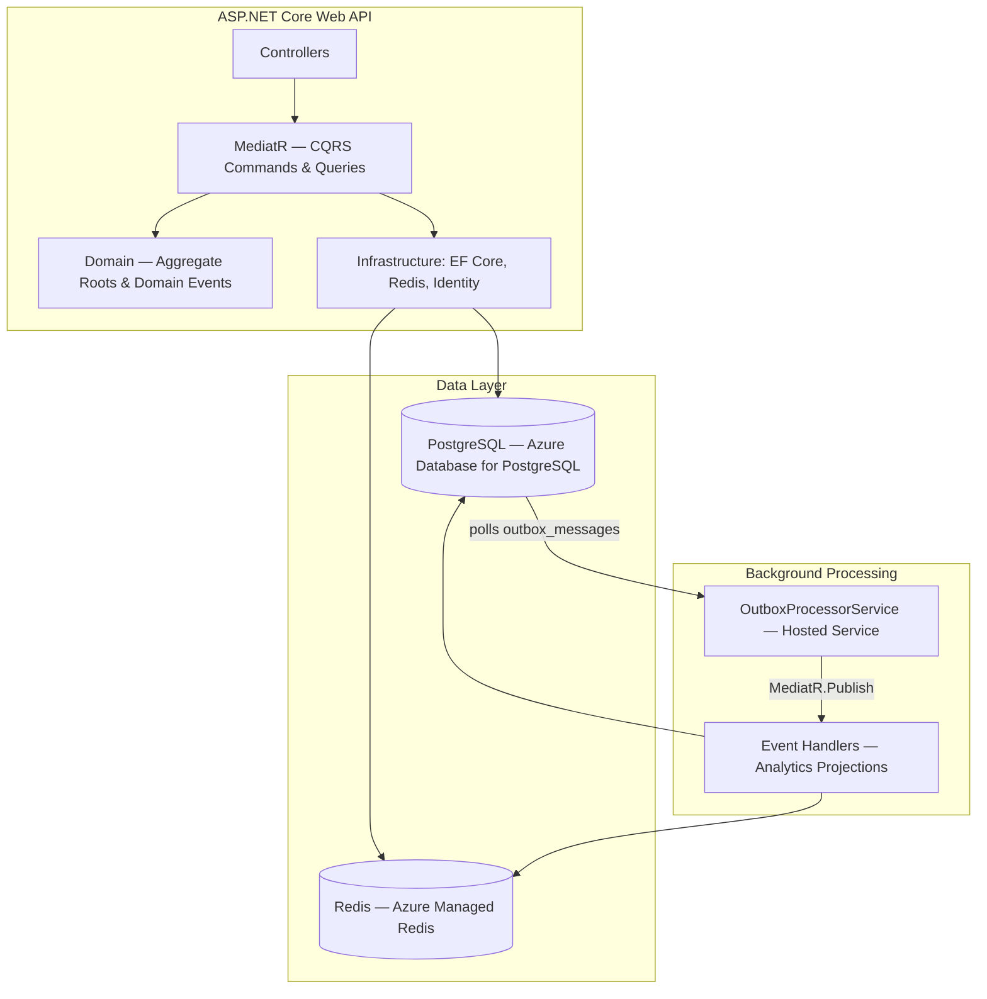

# TaskFlow

**Cloud-Native, Event-Driven Task & Analytics Orchestration API**

A multi-tenant SaaS backend built in strict Clean Architecture, using CQRS, the Outbox pattern for reliable event-driven analytics, JWT authentication, and a Redis caching layer — deployed live on Azure App Service.

🔗 **Live API + Swagger:** https://taskflo-akh9andch9eteec3.southeastasia-01.azurewebsites.net/swagger

---

## What this is

TaskFlow is a task/project management API where every meaningful state change (a task being created, completed, reassigned) raises a **domain event**. Those events are persisted transactionally alongside the state change itself (the **Outbox pattern**), then drained by a background worker into an analytics read model — so completion metrics are always derived from durable, crash-safe event history rather than being computed on the fly.

This project exists to demonstrate patterns used in real production distributed systems — not just CRUD — as part of a structured portfolio build.

---

## Architecture



**Clean Architecture, four layers, strict dependency direction (outer → inner only):**

```
TaskFlow.Domain          → entities, domain events, no external dependencies
TaskFlow.Application     → CQRS handlers, validation, depends only on Domain
TaskFlow.Infrastructure  → EF Core, Redis, JWT, Outbox processor, depends on Application
TaskFlow.API             → controllers, composition root, depends on Application + Infrastructure
```

---

## Key patterns implemented

| Pattern | Where |
|---|---|
| **CQRS via MediatR** | Every write is a `Command`, every read is a `Query`, each with its own handler |
| **Outbox pattern** | `DispatchDomainEventsInterceptor` writes domain events to `outbox_messages` in the *same transaction* as the state change — guarantees the event is never lost even if the process crashes right after commit |
| **Aggregate roots** | `TaskItem` enforces its own invariants (`ChangeStatus`, `AssignTo`) — no public setters, no way to construct an invalid state |
| **Multi-tenancy** | Every query is scoped by `OrganizationId` sourced from the JWT, never from client input |
| **JWT auth** | Short-lived access tokens (15 min) + rotating refresh tokens, stored hashed (SHA-256), never in plaintext |
| **FluentValidation pipeline behavior** | Validation runs automatically for every command/query via a MediatR `IPipelineBehavior`, not manually in each handler |
| **Cross-cutting exception handling** | Typed exceptions (`NotFoundException`, `ForbiddenAccessException`, etc.) map to RFC 7807 `ProblemDetails` in one place, not scattered across controllers |
| **Read-model caching** | Analytics snapshots are cached in Redis after every completion event, so a future dashboard never needs to hit Postgres for "today's numbers" |

---

## Tech stack

**Backend:** ASP.NET Core (.NET 10) · EF Core · MediatR · FluentValidation
**Data:** PostgreSQL (Azure Database for PostgreSQL Flexible Server) · Redis (Azure Managed Redis)
**Auth:** JWT Bearer, BCrypt password hashing
**Hosting:** Azure App Service
**Docs:** Swagger / OpenAPI (Swashbuckle)

---

## API overview

| Method | Endpoint | Description |
|---|---|---|
| `POST` | `/api/auth/register` | Create a new organization + owner user, returns tokens |
| `POST` | `/api/auth/login` | Authenticate, returns tokens |
| `GET` | `/api/projects` | List projects for the current organization |
| `POST` | `/api/projects` | Create a project |
| `POST` | `/api/tasks` | Create a task under a project |
| `GET` | `/api/tasks/by-project/{projectId}` | Paginated task list for a project |
| `PATCH` | `/api/tasks/{id}/status` | Update a task's status (raises `TaskCompletedEvent` when moved to Done) |

Full request/response schemas are in the live Swagger UI linked above.

---

## Running locally

**Prerequisites:** .NET 10 SDK, Docker Desktop, `dotnet-ef` (`dotnet tool install --global dotnet-ef`)

```bash
# 1. Start local Postgres
docker run --name taskflow-postgres -e POSTGRES_PASSWORD=postgres -e POSTGRES_DB=taskflow -p 5432:5432 -d postgres:16

# 2. Start local Redis
docker run --name taskflow-redis -p 6379:6379 -d redis:7

# 3. Set a real JWT secret in TaskFlow.API/appsettings.Development.json (32+ random characters)

# 4. Apply migrations
dotnet ef database update -p TaskFlow.Infrastructure -s TaskFlow.API

# 5. Run
dotnet run --project TaskFlow.API
```

Swagger UI opens at `https://localhost:<port>/swagger`.

---

## Engineering notes / things I actually debugged

A few non-obvious issues hit during development, kept here because working through them was as much the point of this project as the CRUD parts:

- **Swagger's Authorize dialog silently not attaching the JWT to requests.** The security *requirement* registered the same `OpenApiSecurityScheme` object used for the security *definition*, without setting its `Reference` back to the definition's name. Swagger UI accepted the token and showed "authorized," but the generated OpenAPI document never actually linked any endpoint to that scheme — so the header was never attached. Fixed by using a separate scheme instance in the requirement that only carries an `OpenApiReference` pointing at `"Bearer"`.
- **`UseXminAsConcurrencyToken()` was removed** from a newer version of Npgsql's EF Core provider after this project started. Replaced with the maintainers' recommended pattern: a shadow `uint` property mapped to Postgres's `xmin` system column with `IsRowVersion()`.
- **StackExchange.Redis version drift** introduced an `Expiration` struct overload of `StringSetAsync` that a bare `TimeSpan?` argument couldn't resolve against — resolved by explicitly selecting the still-supported `(TimeSpan?, bool keepTtl, ...)` overload.
- **Azure Cache for Redis was retired mid-project** in favor of Azure Managed Redis — different port (10000 vs 6380), different hostname suffix, same underlying protocol, no code changes needed since the app authenticates via access key rather than Entra ID tokens.

---

## Roadmap

- [x] Domain + Application layers (CQRS, aggregate roots, domain events)
- [x] Infrastructure layer (EF Core, Outbox interceptor, Redis, JWT)
- [x] API layer, deployed live to Azure App Service
- [x] Outbox background processor + analytics event handlers
- [ ] React + TypeScript frontend
- [ ] Dockerfiles + Docker Compose for local multi-service dev
- [ ] GitHub Actions CI (lint, xUnit tests, build & push images)
- [ ] Infrastructure-as-code (Bicep) for the Azure deployment

---

## A note on licensing

This project uses MediatR v14, which requires a commercial license for production use (free for development/testing). Since this is a portfolio project rather than a commercial product, this is disclosed here rather than worked around.